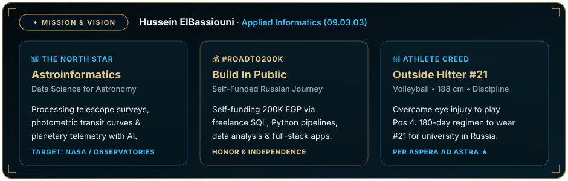
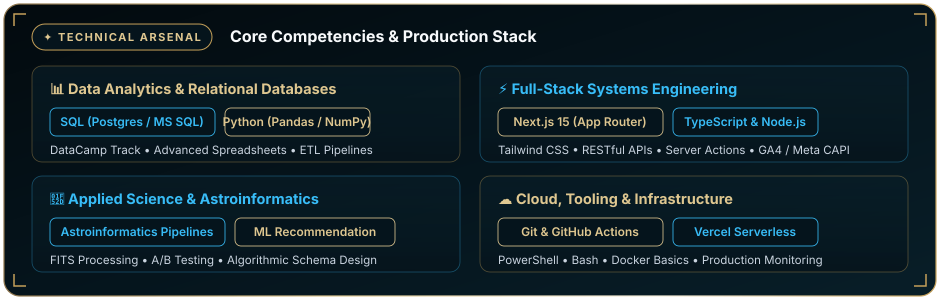
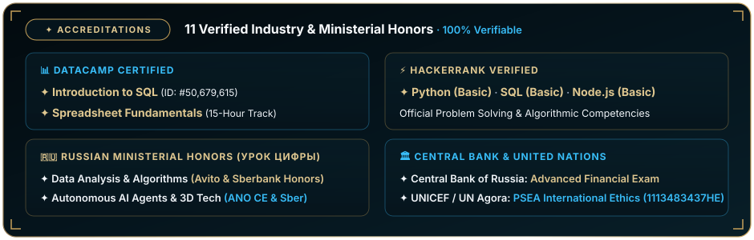
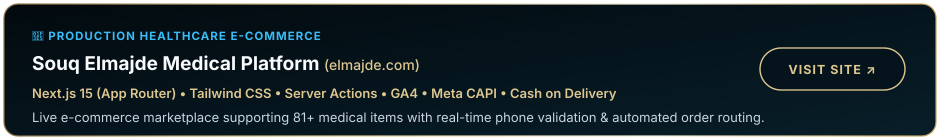
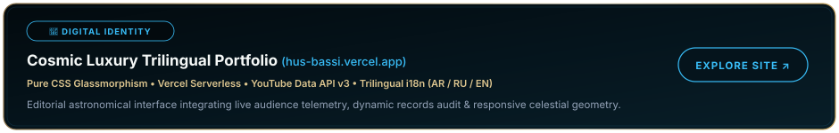
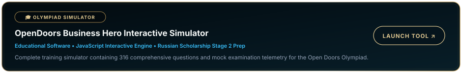

<!-- Hero Banner (Custom Animated SVG - Cosmic Luxury Edition) -->

 

<!-- Status Badges with Official Brand Palette (#030a0e, #05141c, #c5a059, #dfc790, #38bdf8) -->

  
  
  
  

 

<!-- ✦ 01 // MISSION & NORTH STAR CARD -->

  

<!-- ✦ 02 // TECHNICAL ARSENAL CARD -->

  

<!-- ✦ 03 // INSTITUTIONAL ACCREDITATIONS CARD -->

  

<!-- ✦ 04 // FEATURED PRODUCTION PROJECTS -->

 

<!-- Project 1: Souq Elmajde -->

 

<!-- Project 2: Cosmic Luxury Portfolio -->

 

<!-- Project 3: OpenDoors Hero Simulator -->

  

<!-- Connect Bar -->

  
  
  
  
  

 

<!-- Animated Footer Banner -->

 

<!-- Accessible Plain-Text Summary for Recruiters & Screen Readers -->

<b>📄 Plain-Text Overview &amp; Direct Verification Links (للقراءة والنسخ السريع)</b>

 

### About Hussein Mohamed Mostafa Ahmed ElBassiouni
* **Arabic:** حسين محمد مصطفى أحمد البسيوني · **Russian:** Хуссейн Мохамед Мостафа Ахмед Эльбассиуни
* **Degree Track:** Bachelor of Applied Informatics (`09.03.03 Прикладная информатика`), Russian Government Scholarship.
* **North Star:** Astroinformatics & Astronomy Data Science (NASA / International Astronomical Observatories).
* **#RoadTo200K:** Self-funding immigration and CUDA hardware via freelance data analytics and systems engineering.
* **Athlete Creed:** Competitive Volleyball Outside Hitter (188 cm, Jersey #21). Motto: *Per Aspera Ad Astra*.

### Technical Stack & Arsenal
* **Data Analytics:** SQL (PostgreSQL, SQL Server), Python (NumPy, Pandas), Spreadsheets (Advanced).
* **Full-Stack:** Next.js 15, TypeScript, Node.js, Express, Tailwind CSS, REST APIs.
* **Applied Science:** Astroinformatics pipelines, recommendation algorithms, A/B testing, relational schemas.
* **Tooling:** Git, GitHub, Vercel Serverless, Google Analytics 4, Meta CAPI, Bash, PowerShell.

### 11 Verified Accreditations
1. **DataCamp:** Introduction to SQL (Credential `#50,679,615` · Hash: `91bd837acdfb16ef28a3445499ee36ff1057e3ff`)
2. **DataCamp:** Spreadsheet Fundamentals Track (Hash: `3cee210eb30f190f056caaf9324a87e9185cdc46`)
3. **HackerRank:** Python Basic (`5250E60817B2`)
4. **HackerRank:** SQL Basic (`30601B8D3259`)
5. **HackerRank:** Node.js Basic (`E43713D1B35B`)
6. **Russian Ministerial Honors:** Data Analysis & Recommendation Algorithms (Avito & Sberbank)
7. **Russian Ministerial Honors:** Autonomous AI Agents (ANO Digital Economy)
8. **Russian Ministerial Honors:** AI & 3D Technologies (Sberbank)
9. **Central Bank of Russia:** Financial Examination (Advanced Level)
10. **Central Bank of Russia:** Financial Examination (Basic Level)
11. **UN Agora / UNICEF:** PSEA Human Rights (Code: `1113483437HE`)
* **Official Recommendation Letters:** Supported by stamped letters from NUST MISIS, NSUEM, USPTU, VSUET, and BSU.

### Production Projects
* **[Souq Elmajde Medical Platform](https://elmajde.com/):** Production Next.js 15 e-commerce marketplace for medical supplies.
* **[Cosmic Luxury Portfolio](https://hus-bassi.vercel.app/):** Trilingual personal portfolio with live telemetry and pure CSS glassmorphism.
* **[OpenDoors Business Hero Simulator](https://hus-bassi.vercel.app/):** Interactive 316-question exam prep simulator for Russian scholarship applicants.

