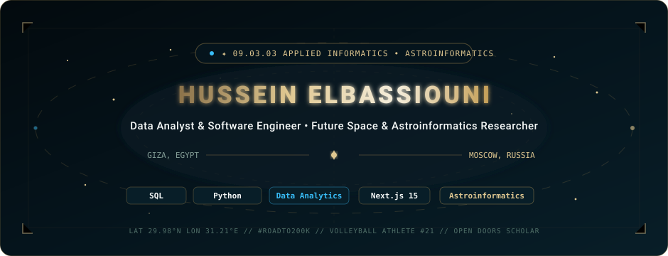

<!-- Hero Banner (Custom Animated SVG - Cosmic Luxury Edition) -->

 

<!-- Status Badges with Portfolio Color Tokens (#030a0e, #05141c, #c5a059, #dfc790, #38bdf8) -->

  
  
  
  

---

### ✦ About Me & The Mission

I am **Hussein Mohamed Mostafa Ahmed ElBassiouni** (حسين البسيوني · *Хуссейн Эльбассиуни*), an Egyptian Software Engineer and Data Analyst actively preparing for a Bachelor’s degree in **Applied Informatics** (`09.03.03 Прикладная информатика`) under the full Russian Government Scholarship quota.

* 🔭 **The North Star:** Dedicating my academic and engineering career to **Astroinformatics & Astronomy Data Science** — processing multi-wavelength telescope feeds, photometric datasets, and celestial telemetry for global astronomical research.
* 💰 **#RoadTo200K (#رحلة_الـ200_ألف):** Building in public from zero. Self-funding all travel preparations, high-performance CUDA hardware, and immigration costs through freelance data analysis, full-stack systems engineering, and academic dedication.
* 🏐 **Athlete Mindset:** Competitive volleyball Outside Hitter (188 cm) dedicated to Jersey **#21**. Living by the creed: *«Through Hardship to the Stars»* (*Per Aspera Ad Astra*).

---

### 🛠️ Core Competencies & Technical Arsenal

| Domain | Verified Stack & Tools |
| :--- | :--- |
| **Data Analytics & Databases** | `SQL (PostgreSQL, SQL Server)` • `Python (NumPy, Pandas)` • `Spreadsheets (Advanced Formulas & Pivot Tables)` • `DataCamp Associate Track` |
| **Full-Stack Engineering** | `Next.js 15 (App Router, Server Actions)` • `Node.js & Express` • `TypeScript / JavaScript (ES2024)` • `Tailwind CSS` • `RESTful APIs` |
| **Applied & Scientific Computing** | `Astroinformatics Pipelines` • `Machine Learning Recommendation Systems` • `A/B Testing Methodologies` • `Relational Database Schemas` |
| **Tooling, Cloud & CI/CD** | `Git & GitHub` • `Vercel Serverless Functions` • `Docker Basics` • `Google Analytics 4 & Meta CAPI` • `Bash / PowerShell` |

---

### 🏆 Verified Academic & Industry Accreditations

All credentials are 100% verified with official issuer IDs, digital hashes, and verifiable records:

* 📊 **DataCamp:**
  * **Introduction to SQL** *(Credential `#50,679,615` · Hash: `91bd837acdfb16ef28a3445499ee36ff1057e3ff`)*
  * **Spreadsheet Fundamentals (15-Hour Skill Track)** *(Hash: `3cee210eb30f190f056caaf9324a87e9185cdc46`)*
* ⚡ **HackerRank Verified Skills:**
  * **Python (Basic)** *(ID: `5250E60817B2`)* • **SQL (Basic)** *(ID: `30601B8D3259`)* • **Node.js (Basic)** *(ID: `E43713D1B35B`)*
* 🇷🇺 **Russian Federal & Ministerial Honors (Урок цифры):**
  * **Data Analysis & Recommendation Algorithms (Honors)** — *Ministry of Digital Development & Ministry of Education of RF, Avito & Sberbank*
  * **Autonomous AI Agents (Honors)** — *Ministry of Digital Development of RF & ANO Digital Economy*
  * **AI & 3D Technologies (Honors)** — *Ministry of Digital Development of RF & Sberbank*
* 🏛️ **Central Bank of Russia (Банк России):**
  * **All-Russian Financial Examination — Advanced Level** *(ID: `33f2e1ce-83b3-469b-980d-83b28b76eb1f`)*
  * **All-Russian Financial Examination — Basic Level** *(ID: `39f972b2-5f60-4f51-b01e-c5ca91d84862`)*
* 🌐 **United Nations & International Action:**
  * **PSEA Human Rights & International Ethics Certification** — *UNICEF / UN Agora Platform (Code: `1113483437HE`)*
* 📜 **Official University Support Letters (09.03.03 Applied Informatics):**
  * Supported by official recommendation letters from **NUST MISIS (Moscow)**, **NSUEM (Novosibirsk)**, **USPTU (Ufa)**, **VSUET (Voronezh)**, and **BSU (Bryansk)**.

---

### 🚀 Featured Production Projects

#### 1. [Souq Elmajde Medical Platform](https://elmajde.com/)
> **Next.js 15 • Tailwind CSS • Google Tag Manager • Meta Pixel & CAPI • Cash on Delivery Engine**
* Production full-stack medical and healthcare equipment marketplace supporting 81+ medical catalog items.
* Tailored for high conversion across Egyptian commerce: real-time phone validation, server-side dynamic cart state, and automated order routing.

#### 2. [Cosmic Luxury Trilingual Portfolio](https://hus-bassi.vercel.app/)
> **Vanilla JS • Vercel Serverless Functions • Google YouTube Data API v3 • Internationalization (AR / RU / EN)**
* High-performance editorial digital presence engineered with pure CSS glassmorphism, zero-void responsive grid, and live audience telemetry.
* Live endpoint fallback architecture aggregating real-time analytics across social platforms.

#### 3. [OpenDoors Business Hero Interactive Simulator](https://hus-bassi.vercel.app/)
> **Educational Engineering • JavaScript • Desktop & Web Application**
* Complete interactive preparation simulator containing 316 comprehensive questions designed to train scholars for the Open Doors Russian Scholarship Olympiad Stage 2 examination.

---

### 🌌 Connect & Professional Network

 

<!-- Animated Footer Banner -->

